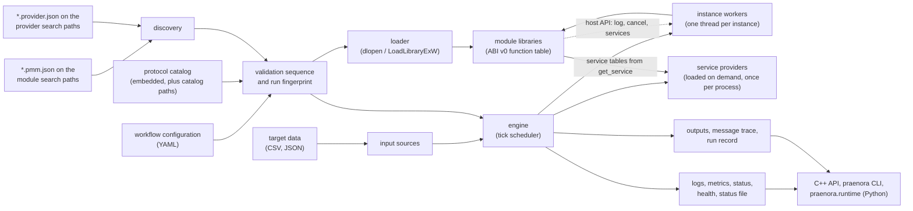
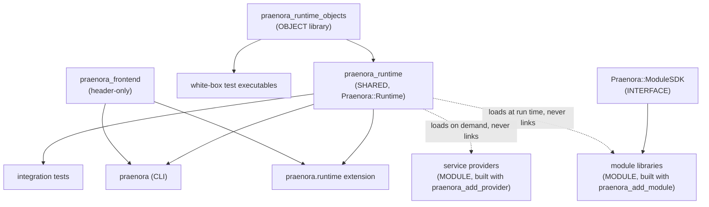
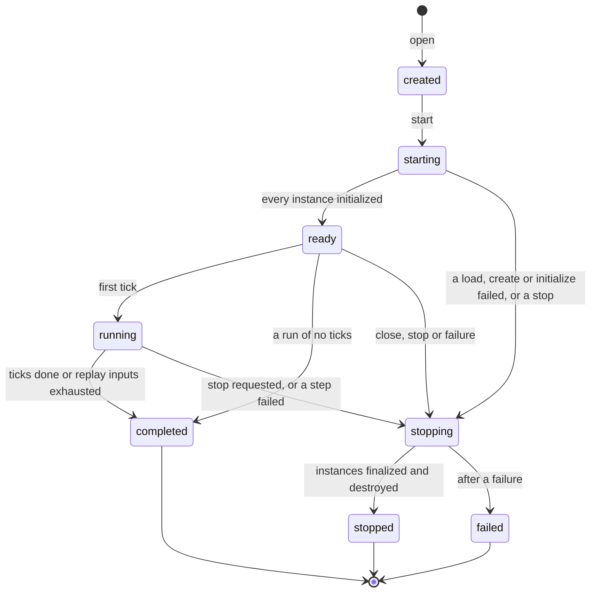
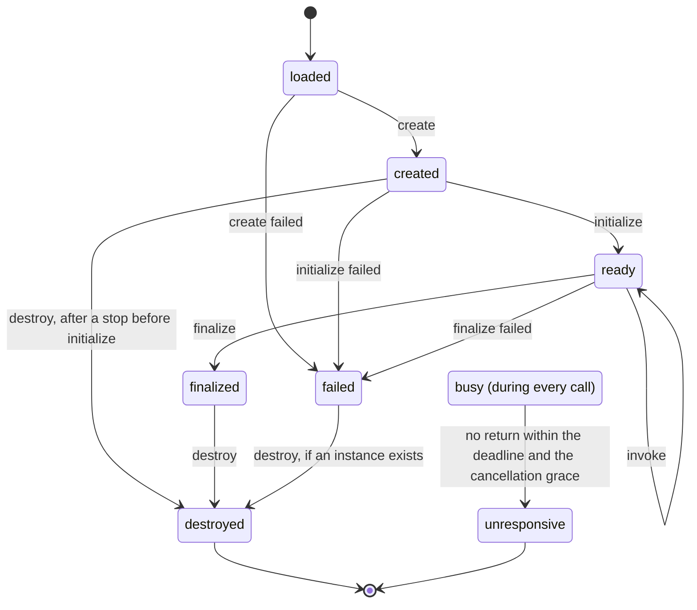

# Architecture

This document shows how `praenora-runtime` is put together: its components, how data flows
through a run, and the life of a run and of a module instance. The normative rules are in the
specifications under [specs/](index.md#normative-specifications); the decisions behind them are in
the [ADRs](adr/README.md).

## The parts

- **Runtime (host).** The shared library `praenora_runtime` (`Praenora::Runtime`). It validates a
  workflow configuration, discovers and loads modules, runs the workflow in ticks and reports
  status, metrics and logs.
- **Module SDK.** `Praenora::ModuleSDK`: the C ABI v0 headers, the optional header-only C++
  adapter, the in-process test kit and the CMake helper `praenora_add_module()`. Modules build
  against it and nothing else ([module-developer-guide.md](module-developer-guide.md)).
- **Protocol.** The Praenora Module Protocol (PMP) and the Praenora Module Manifest (PMM): the
  document schemas in [`spec/schemas/`](../spec/schemas/), the protocol catalog of message types,
  capabilities and workflow definitions in [`spec/catalog/`](../spec/catalog/), and the generated
  AsyncAPI documents in [`spec/asyncapi/`](../spec/asyncapi/). Schemas and catalog are embedded in
  the runtime.
- **Surfaces.** The public C++ API (`praenora::Runtime`, `praenora::Workflow`), the `praenora`
  command-line tool ([user-guide.md](user-guide.md)) and the Python package `praenora.runtime`
  ([python.md](python.md)). The tool and the Python package are thin layers over the C++ API.

Modules are not part of this repository: they are independently built libraries, each described by
a manifest, that the runtime finds on module search paths and loads at run time. The repository
holds only the two example modules (`examples/modules/`) and the fixture modules of the tests
(`tests/fixtures/modules/`).

Service providers are the runtime's own: separately built libraries, shipped with the runtime, that
bring heavy engines for runtime services, such as the simulation engine behind
`praenora.simulation@0` ([Service providers](#service-providers)). The repository holds the
optional provider `roadrunner` (`src/providers/roadrunner/`) and the fixture providers of the tests
(`tests/fixtures/providers/`).

## Components

The runtime's internals live in `src/runtime/`, one directory per component, in the namespace
`praenora::detail`:

| Directory | Responsibility |
|---|---|
| `core/` | Error table, semantic versions, durations, wall-clock time, SHA-256, seed derivation, UTF-8 paths. |
| `document/` | YAML and JSON loading with source positions, canonical JSON, the embedded resources and the JSON Schema registry. |
| `catalog/` | Loading and indexing message types, capabilities and workflow definitions; catalog consistency. |
| `config/` | The workflow configuration: schema, defaults, relative paths, overrides. |
| `discovery/` | Module search paths, manifest loading and the module index; what module and provider discovery share (search paths, reading a manifest). |
| `compat/` | Compatibility of a manifest with the host: platform, ABI, protocol, capabilities. |
| `loader/` | Opening libraries (`platform/posix/`, `platform/windows/`), function-table checks, the identity check, library digests, and the process-wide gate of each loaded library, which orders the calls into it and refuses those behind an abandoned call. |
| `provider/` | Service providers: provider manifests, the provider index and the resolution of services, the process-wide provider loader, and the internal provider interface `provider_abi.h`. |
| `instance/` | One module instance: its worker thread, lifecycle state, host API, deadlines and cancellation; the services it sees and the registry of built-in services. |
| `graph/` | Validating a workflow definition's graph and computing its schedule. |
| `engine/` | Running ticks: routing messages, building envelopes, checking results, failure handling. |
| `io/` | Input sources (observation CSV replay, JSON documents), output files, the message trace, the run record. |
| `observability/` | Logging, metrics, status snapshots, health and the status-file writer. |
| `api/` | The public `Runtime` and `Workflow`, the validation sequence, graph export and the contract checks. |
| `platform/` | Operating-system calls: environment variables, the runtime's own location, shared libraries. |

Outside the runtime:

| Directory | Contents |
|---|---|
| `include/praenora/runtime/` | The public C++ API. |
| `include/praenora/sdk/` | The module SDK: `abi.h`, `status.h`, `simulation.h` (the simulation service), `module.hpp`, `testing.hpp`. |
| `src/sdk/` | The `Praenora::ModuleSDK` target and the generated `version.h`. |
| `src/providers/` | Service providers built with the runtime: `roadrunner/`, only with `PRAENORA_WITH_ROADRUNNER`. |
| `src/frontend/` | What the CLI and the Python extension share (header-only, internal). |
| `src/cli/` | The `praenora` tool. |
| `src/python/`, `python/praenora/runtime/` | The SWIG facade and the pure-Python package. |

## Build structure

- The runtime compiles once, into an OBJECT library. The shared library exports only the public
  API (the `praenora` namespace); statically linked dependencies stay internal. White-box tests link
  the objects directly, so they can test internals.
- Third-party libraries (nlohmann/json, json-schema-validator, yaml-cpp, spdlog) link privately.
  Public headers use only the standard library and Praenora types
  ([ADR-0023](adr/ADR-0023-public-cpp-api.md)).
- Modules are always `MODULE` libraries and the runtime always a `SHARED` library;
  `BUILD_SHARED_LIBS` is never read. The runtime never links against a module: it opens module
  libraries with `dlopen` (POSIX) or `LoadLibraryExW` (Windows) and calls them only through the
  function table that `praenora_module_get_api` returns
  ([specs/module-abi.md](specs/module-abi.md)). Service providers are `MODULE` libraries too,
  opened the same way and called only through the table of `praenora_provider_get_api`, the only
  symbol they export; the roadrunner provider links its engine statically behind that export list.

## A run, from configuration to outputs

1. **Validation.** `Runtime::open()` (or `praenora validate`, `praenora run`) parses the
   configuration with source positions, checks it against its schema, resolves the workflow
   definition and the catalog entries it uses, validates the graph, checks the bindings, discovers
   and resolves the modules from their manifests (no module code runs), resolves the services they
   declare to service providers (nothing is loaded), validates parameters and fills in their
   defaults, reads and checks the input data, and computes the run fingerprint. Every problem is
   collected in one report before anything runs.
2. **Start.** First the providers of the run's services are loaded and started, each once per
   process. Then the steps start one at a time, in schedule order: the step's module library is
   loaded and checked (function table, `describe()` identity) unless an earlier step loaded it,
   then an instance is created and initialized for the step.
3. **Ticks.** In tick `t`, every workflow input first produces its message for the tick's
   logical-time window. Each step then runs once, in schedule order: it receives the messages of
   its delay-0 inputs from this tick and of its delay-1 inputs from the previous tick. The runtime
   checks each result against the port's message type, wraps it in an envelope and passes it on;
   messages that reach workflow outputs are recorded.
4. **End.** A run completes after `run.ticks` ticks or when its replay inputs are exhausted; it
   stops on request and fails at the first step failure. Either way the instances are finalized and
   destroyed in reverse order, the libraries unloaded and the run record written.

The rules are in [specs/protocol.md](specs/protocol.md#execution-semantics) and
[specs/workflow-definitions.md](specs/workflow-definitions.md); time and stopping in
[specs/time-cancellation-timeouts.md](specs/time-cancellation-timeouts.md); the fingerprint and the
files a run writes in [specs/reproducibility.md](specs/reproducibility.md).

A run that completes is wound down within the call that runs its last tick (within `start()` for a
run of no ticks); `close()` ends a run that is still ready or running as stopped, with the same
teardown.

## States

A workflow (one run) moves through these states; `praenora status` and every status snapshot show
the current one:

`stopping` is the teardown of a run that did not complete: its instances are finalized and
destroyed, and its files finished, before the final state is set.

Each step's module instance has a lifecycle of its own, seen from the host
([specs/module-abi.md](specs/module-abi.md#lifecycle)):

Each arrow from `loaded` to `destroyed` is a call into the module. While a call runs, the instance
is `busy`; when it returns, the instance takes the arrow's target state. `diagnostics`, and
`self_test` in the contract checks, return to the state they started from. An invocation leaves the
instance `ready` whether it succeeded, failed, timed out or was cancelled, so it is still finalized.
A call that does not return within its deadline and the cancellation grace makes the instance
`unresponsive`, whatever state it started from: it is never destroyed, its thread is left running
and its library stays loaded for the rest of the process. An unresponsive `create`, `initialize`
or `invoke` fails the run with `MODULE_UNRESPONSIVE`; a `finalize` or `destroy` of the teardown,
or a `diagnostics` call made while a failure is reported, leaves the run's ending as it was
([specs/time-cancellation-timeouts.md](specs/time-cancellation-timeouts.md#deadlines)). Unless the
manifest declares `features.concurrency: "instance"`, no other instance of that library is called
while the abandoned call may still be running, in this run or in any other run or contract-check
session of the process: their calls, and loads of the library, are refused with
`MODULE_UNRESPONSIVE`, and a teardown leaves such instances as they are
([specs/threading-and-ownership.md](specs/threading-and-ownership.md#unresponsive-instances)).
Each loaded library has one gate for the whole process, which also makes the calls of concurrent
runs into a `"module"` library take turns
([specs/threading-and-ownership.md](specs/threading-and-ownership.md#concurrency-across-instances)).

A `create` that does not succeed leaves no instance to destroy, except one that returned OK with an
instance after its deadline: that instance is destroyed later. After a failed `initialize` the
instance is destroyed without `finalize`. A stop between `create` and `initialize` destroys the
created instance, and a stop before `create` leaves the instance `loaded`.

## Threads

| Thread | Does |
|---|---|
| The caller's thread | Runs the workflow: validation, `start()`, every tick, `close()`. One module call is in flight at a time. |
| `praenora:<step>` | One worker per module instance. Every call into that instance, from create to destroy, runs here, so module state is thread-affine. The caller waits for each call on a deadline. |
| `praenora:status` | Rewrites the status file, when one is configured. |
| The CLI's signal watcher | Turns SIGINT and SIGTERM (Ctrl+C on Windows) into `Workflow::request_stop()`. |

Status and metrics queries, and `request_stop()`, may come from any thread while a run is in
progress; they read a copy of the state kept under a mutex and never wait for module code. Modules
may call the host API (logging, cancellation, services) from any thread of their own while their
instance exists ([specs/threading-and-ownership.md](specs/threading-and-ownership.md)).

## Service providers

A service provider is a separately built `MODULE` library, described by a `*.provider.json`
manifest, that brings an engine for one or more runtime services
([specs/runtime-services.md](specs/runtime-services.md),
[ADR-0026](adr/ADR-0026-runtime-service-providers.md)).

- **Where it sits.** Providers are found on provider search paths (the caller's,
  `PRAENORA_PROVIDER_PATH`, then the installation's `<prefix>/lib/praenora/providers`) and indexed
  from their manifests by `src/runtime/provider/`, without loading anything. Their interface,
  `provider_abi.h`, is internal: providers are built in this repository with
  `praenora_add_provider()`, and a provider is usable only with the runtime version it was built
  with.
- **Resolution.** Validation resolves each service that a step's module declares in its manifest
  (PMM 0.2) to the first usable provider that offers it; a required service that no provider serves
  fails validation with `SERVICE_UNAVAILABLE`.
- **Loading and lifetime.** When a run starts, before any module library is loaded, the runtime
  loads each provider of the run's services, checks its library's digest, its table and its
  identity, and calls its `start()`. This happens once per process, whichever `Runtime` asks
  first: a provider is never unloaded, so one engine, with its process-wide state, serves every run
  of the process. `validate --load` and the contract checks load providers the same way.
- **From a module to the engine.** A module asks its instance's host API for a service with
  `get_service(name, major)`, usually in `create`. It gets the provider's table only when its
  manifest declares the service and the service resolved for the run. From then on the module calls
  the table's functions directly, from its worker thread or threads of its own; the runtime is not
  in between. The simulation service's table hands out sessions, plans and kernels, which the
  provider owns and the module closes ([specs/simulation-service.md](specs/simulation-service.md)).
- **Records.** The run record names each service the run uses, with its provider's identity,
  digests and engine, so the run fingerprint changes when the engine does.

## What is configured, and what is not

- **Topology is catalog data.** Which steps a workflow has, which capability each step needs and how
  steps connect come from a versioned workflow definition in the protocol catalog. The runtime
  hard-codes no module, step, order or connection. A new workflow is a new catalog entry, and a
  changed one a new version of it once versions are bumped again; for now an entry changes in
  place ([ADR-0010](adr/ADR-0010-workflow-definitions-as-catalog-data.md),
  [specs/compatibility-policy.md](specs/compatibility-policy.md#changing-a-version)).
- **The configuration binds.** A workflow configuration pins one definition, binds each step to a
  module (name and exact version) with parameters, binds each workflow input to a data source, and
  sets run, output and logging options ([configuration.md](configuration.md)).
- **Modules implement capabilities.** Any module whose manifest declares a step's capability can be
  bound to the step: modules of the same capability are interchangeable.
- **Runtime services** reach modules through the host API's `get_service(name, major)`, and a
  module sees a provider's service only when its manifest declares it
  ([Service providers](#service-providers)). The simulation service `praenora.simulation@0`
  ([specs/simulation-service.md](specs/simulation-service.md)) is offered by the optional provider
  `roadrunner` and, in the tests, by the fixture provider `test-simulation`. Compiling module code
  through libRoadRunner ([feasibility/libroadrunner.md](feasibility/libroadrunner.md)) and the
  model conversion service ([feasibility/libantimony.md](feasibility/libantimony.md)) are designs
  only.

## Security

- **Modules are trusted code.** A module runs inside the runtime's process with its privileges, and
  runs load only libraries named by manifests on the module search paths
  ([specs/module-abi.md](specs/module-abi.md#trust)).
- **No network access.** The runtime opens no network connection: it reads and writes files only,
  and other processes follow a run through its status file
  ([ADR-0015](adr/ADR-0015-observability.md); a network endpoint is OQ-9). A module, being native
  code, is not bound by this. A default build downloads nothing either
  ([ADR-0017](adr/ADR-0017-dependency-management.md)).
- **Documents are data.** Configurations, catalog entries, manifests and messages are parsed and
  checked against their schemas, never evaluated as code, and a message's content, a model source
  included, is the receiving module's to interpret
  ([configuration.md](configuration.md#document-rules),
  [specs/protocol.md](specs/protocol.md#documents-and-schemas)).

## References

- [ADR-0003](adr/ADR-0003-native-module-abi-v0.md), [ADR-0006](adr/ADR-0006-threading-model.md),
  [ADR-0011](adr/ADR-0011-tick-based-synchronous-execution.md),
  [ADR-0023](adr/ADR-0023-public-cpp-api.md): the decisions this structure follows.
- [specs/module-abi.md](specs/module-abi.md), [specs/protocol.md](specs/protocol.md),
  [specs/observability.md](specs/observability.md): the normative details.
- [developer-guide.md](developer-guide.md): building, debugging and changing the runtime.
