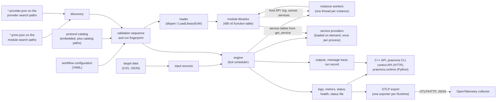
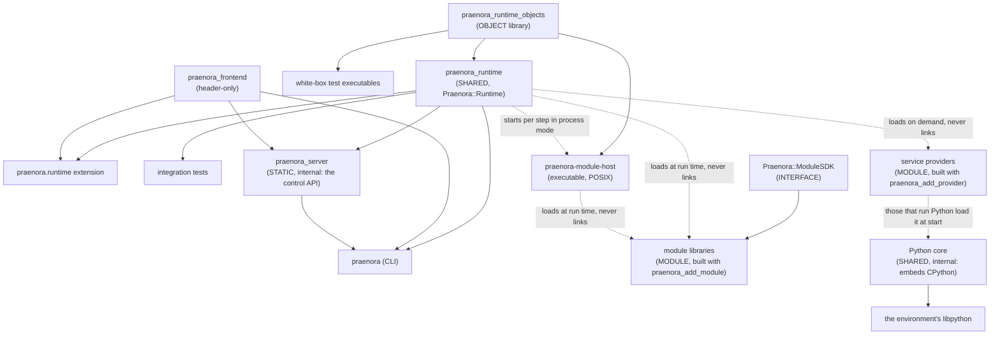
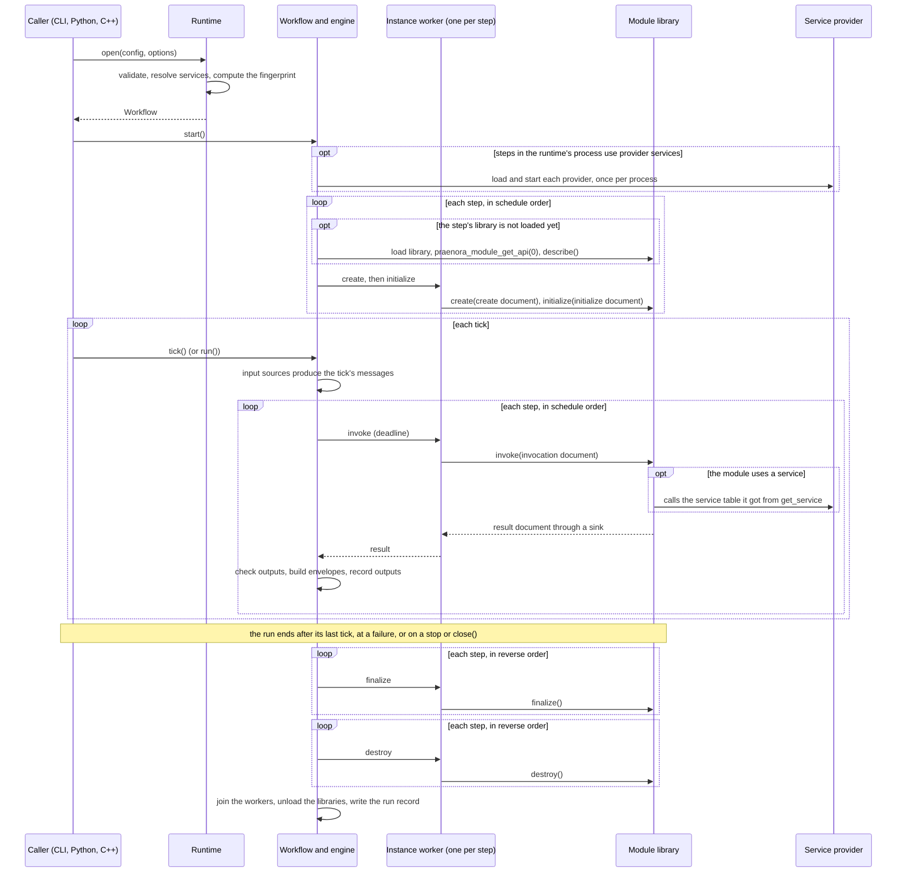
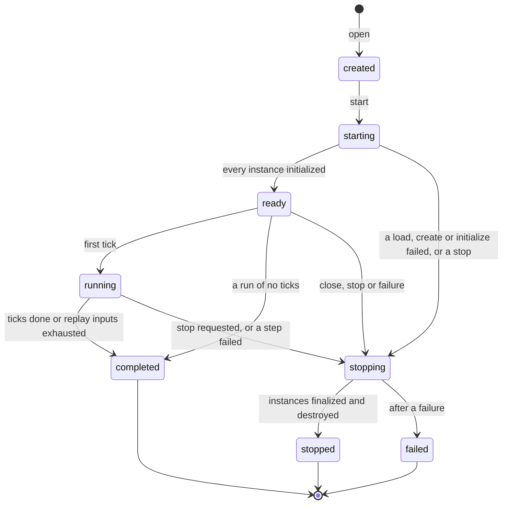
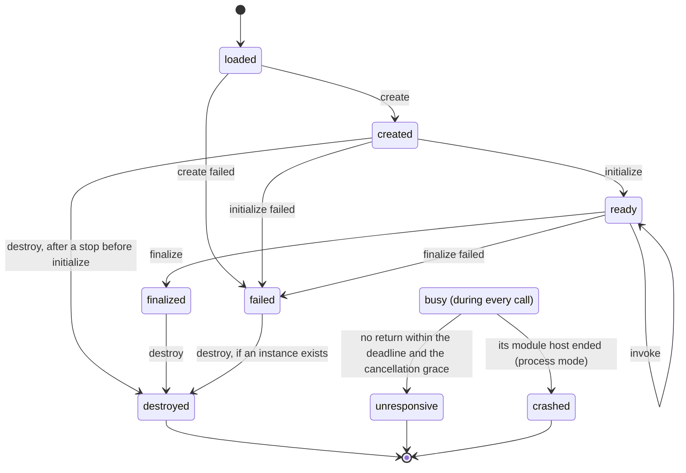
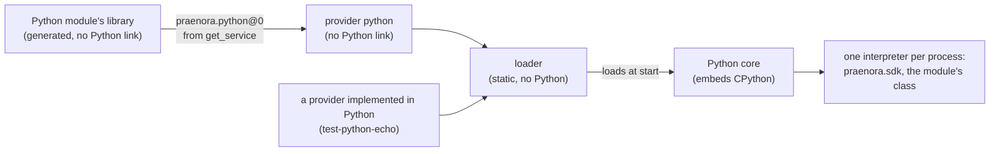
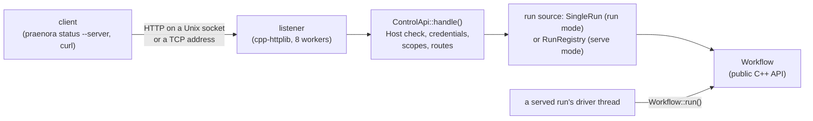

# Architecture

This document shows how `praenora-runtime` is put together: its components, how data flows
through a run, and the life of a run and of a module instance. The normative rules are in the
specifications under [specs/](index.md#normative-specifications); the decisions behind them are in
the [ADRs](adr/README.md).

## The parts

- **Runtime (host).** The shared library `praenora_runtime` (`Praenora::Runtime`). It validates a
  workflow configuration, discovers and loads modules, runs the workflow in ticks and reports
  status, metrics and logs, which it can also export to an OpenTelemetry collector over OTLP
  ([OTLP export](#otlp-export)).
- **Module SDK.** `Praenora::ModuleSDK`: the C ABI v0 headers, the optional header-only C++
  adapter, the in-process test kit and the CMake helper `praenora_add_module()`. Modules build
  against it and nothing else ([module-developer-guide.md](module-developer-guide.md)). For
  modules in Python, it adds the pure-Python package `praenora.sdk` with its test kit and
  `praenora_add_python_module()`, which generates a Python module's native library
  ([Python modules](#python-modules)).
- **Protocol.** The Praenora Module Protocol (PMP) and the Praenora Module Manifest (PMM): the
  document schemas in [`spec/schemas/`](../spec/schemas/), the protocol catalog of message types,
  capabilities and workflow definitions in [`spec/catalog/`](../spec/catalog/), and the generated
  AsyncAPI documents in [`spec/asyncapi/`](../spec/asyncapi/). Schemas and catalog are embedded in
  the runtime.
- **Surfaces.** The public C++ API (`praenora::Runtime`, `praenora::Workflow`), the `praenora`
  command-line tool ([user-guide.md](user-guide.md)), the control and status API over HTTP, which
  the tool serves ([The control API](#the-control-api)), and the Python package
  `praenora.runtime` ([python.md](python.md)). The tool, the control API's server and the Python
  package are thin layers over the C++ API: its front ends.

Modules are not part of this repository: they are independently built libraries, each described by
a manifest, that the runtime finds on module search paths and loads at run time. The repository
holds only the two example modules (`examples/modules/`) and the fixture modules of the tests
(`tests/fixtures/modules/`).

A step's module instance runs in the runtime's process, or, when the configuration asks for it
(isolation mode `process`), in a module host: the executable `praenora-module-host`, which the
runtime starts for that step alone and reaches over a private channel, so that a crash of the
module ends only its step ([Module hosts](#module-hosts)).

Service providers are the runtime's own: separately built libraries, shipped with the runtime, that
bring heavy engines for runtime services, such as the simulation engine behind
`praenora.simulation@0` and the conversion engine behind `praenora.model-conversion@0`
([Service providers](#service-providers)). The repository holds the optional providers `roadrunner`
(`src/providers/roadrunner/`), `antimony` (`src/providers/antimony/`) and `python`
(`src/providers/python/`), whose engine is the embedded interpreter of a pinned Python environment
behind `praenora.python@0` ([Python modules](#python-modules)), and the fixture providers of the
tests (`tests/fixtures/providers/`).

## Components

The runtime's internals live in `src/runtime/`, one directory per component, in the namespace
`praenora::detail`:

| Directory | Responsibility |
|---|---|
| `core/` | Error table, semantic versions, durations, wall-clock time, SHA-256, seed derivation, UTF-8 paths. |
| `document/` | YAML and JSON loading with source positions, canonical JSON, the embedded resources and the JSON Schema registry. |
| `catalog/` | Loading and indexing message types, capabilities and workflow definitions; catalog consistency. |
| `config/` | The workflow configuration: schema, defaults, relative paths, overrides. |
| `discovery/` | Module search paths, manifest loading and the module index; what module and provider discovery share (search paths, reading a manifest). |
| `compat/` | Compatibility of a manifest with the host: platform, ABI, protocol, capabilities. |
| `loader/` | Opening libraries (`platform/posix/`, `platform/windows/`), function-table checks, the identity check, library digests, and the process-wide gate of each loaded library, which orders the calls into it and refuses those behind an abandoned call. |
| `provider/` | Service providers: provider manifests, the provider index and the resolution of services, the process-wide provider loader, and the internal provider interface `provider_abi.h`. |
| `instance/` | One module instance: its worker thread, lifecycle state, host API, deadlines and cancellation; the services it sees and the registry of built-in services. |
| `isolation/` | Process isolation: the channel to a module host and its frames, the runtime's side of a module host (which stands behind a loaded module's code), the child processes, the store of shared compiled models, the sandbox profiles with a module host's private temporary directory, and the module host's own server, compiled into `praenora-module-host` only. |
| `graph/` | Validating a workflow definition's graph and computing its schedule. |
| `engine/` | Running ticks: routing messages, building envelopes, checking results, failure handling. |
| `io/` | Input sources (observation CSV replay, JSON documents), output files, the message trace, the run record. |
| `observability/` | Logging, metrics, status snapshots, health, the status-file writer, and the path anchors that name a run's directories by placeholders in the error records of the run record, the status file and the control API's status answers; and in `otlp/` the OTLP export: its settings, JSON encoders, HTTP client (the runtime's only source that includes cpp-httplib's header), exporter thread and log sink. |
| `api/` | The public `Runtime` and `Workflow`, the validation sequence, graph export and the contract checks. |
| `platform/` | Operating-system calls: environment variables, the user's home directory, the runtime's own location, shared libraries, child processes (`posix_spawn`). |

Outside the runtime:

| Directory | Contents |
|---|---|
| `include/praenora/runtime/` | The public C++ API. |
| `include/praenora/sdk/` | The module SDK: `abi.h`, `status.h`, `simulation.h` (the simulation service), `model_conversion.h` (the model conversion service), `python.h` (the Python service), `module.hpp`, `python_module.hpp` (the native side of Python modules), `testing.hpp`. |
| `src/sdk/` | The `Praenora::ModuleSDK` target and the generated `version.h`. |
| `python/praenora/sdk/` | The pure-Python package `praenora.sdk`: `Module`, the adapter, the Python core's hooks, the main module of child processes and the test kit. |
| `src/providers/` | Service providers built with the runtime: `roadrunner/`, only with `PRAENORA_WITH_ROADRUNNER`; `antimony/`, only with `PRAENORA_WITH_ANTIMONY`; `python/`, only with `PRAENORA_WITH_PYTHON_ENVIRONMENT`: the Python core (`core/`), the loader and service glue that the providers that run Python link (`common/`) and the provider `python` (`provider/`); `common/`, what providers share (header-only, never installed). |
| `src/module_host/` | The module host `praenora-module-host` (its `main.cpp`; POSIX only), installed in `libexec/praenora/`. |
| `src/frontend/` | What the CLI, the Python extension and the control API's server share (header-only, internal), and `python_environment.hpp`, the variables of the Python environment that the tool and the module host set. |
| `src/server/` | The control API's server, `praenora_server` (static, internal, linked by the tool only): addresses, tokens and scopes, the routes over a run source, the runs of both modes, the Prometheus text, the OpenAPI document, the listener and the client ([The control API](#the-control-api)). |
| `src/cli/` | The `praenora` tool, with the listener flags and the server of `run --listen` and `serve` (`serving.cpp`). |
| `src/python/`, `python/praenora/runtime/` | The SWIG facade and the pure-Python package. |

## Build structure

- The runtime compiles once, into an OBJECT library. The shared library exports only the public
  API (the `praenora` namespace); statically linked dependencies stay internal. White-box tests link
  the objects directly, so they can test internals.
- Third-party libraries (nlohmann/json, json-schema-validator, yaml-cpp, spdlog, and cpp-httplib,
  header-only, through the internal target `praenora_httplib`) link privately. Public headers use
  only the standard library and Praenora types ([ADR-0023](adr/ADR-0023-public-cpp-api.md)).
- The control API's server is a static library over the shared library's public API, linked by the
  `praenora` tool only: the runtime library itself holds no server and opens no listener. The
  OTLP export is part of the runtime library, since C++, the CLI and Python all export
  ([ADR-0042](adr/ADR-0042-control-and-status-api-over-http.md),
  [ADR-0043](adr/ADR-0043-otlp-export-of-metrics-and-logs.md)).
- Modules are always `MODULE` libraries and the runtime always a `SHARED` library;
  `BUILD_SHARED_LIBS` is never read. The runtime never links against a module: it opens module
  libraries with `dlopen` (POSIX) or `LoadLibraryExW` (Windows) and calls them only through the
  function table that `praenora_module_get_api` returns
  ([specs/module-abi.md](specs/module-abi.md)). Service providers are `MODULE` libraries too,
  opened the same way and called only through the table of `praenora_provider_get_api`, the only
  symbol they export; the roadrunner and antimony providers link their engines statically behind
  that export list.
- The Python core, `praenora-python-core`, is the one library that includes `Python.h` and links
  the Python environment's libpython. The providers that run Python link no Python: at their start
  they load libpython and then the core by absolute paths and check the core's build identity
  against their own, so a provider library loads where the environment is missing, and a process
  holds one interpreter whichever provider starts it ([Python modules](#python-modules)).

## A run, from configuration to outputs

1. **Validation.** `Runtime::open()` (or `praenora validate`, `praenora run`) parses the
   configuration with source positions, checks it against its schema, resolves the workflow
   definition and the catalog entries it uses, validates the graph, checks the bindings, discovers
   and resolves the modules from their manifests (no module code runs), resolves the services they
   declare to service providers (nothing is loaded), validates parameters and fills in their
   defaults, reads and checks the input data, and computes the run fingerprint. Every problem is
   collected in one report before anything runs.
2. **Start.** First the providers of the services of the steps that run in the runtime's process
   are loaded and started, each once per process. Then the steps start one at a time, in schedule
   order: the step's module library is loaded and checked (function table, `describe()` identity)
   unless an earlier step loaded it, or, for a step in process mode, a module host of its own is
   started and loads the providers of the step's services and then the module there; then an
   instance is created and initialized for the step.
3. **Ticks.** In tick `t`, every workflow input first produces its message for the tick's
   logical-time window. Each step then runs once, in schedule order: it receives the messages of
   its delay-0 inputs from this tick and of its delay-1 inputs from the previous tick. The runtime
   checks each result against the port's message type, wraps it in an envelope and passes it on;
   messages that reach workflow outputs are recorded.
4. **End.** A run completes after `run.ticks` ticks or when its replay inputs are exhausted; it
   stops on request and fails at the first step failure. Either way the instances are finalized and
   destroyed in reverse order, the libraries unloaded and the run record written.

The rules are in [specs/protocol.md](specs/protocol.md#execution-semantics) and
[specs/workflow-definitions.md](specs/workflow-definitions.md); time and stopping in
[specs/time-cancellation-timeouts.md](specs/time-cancellation-timeouts.md); the fingerprint and the
files a run writes in [specs/reproducibility.md](specs/reproducibility.md).

A run that completes is wound down within the call that runs its last tick (within `start()` for a
run of no ticks); `close()` ends a run that is still ready or running as stopped, with the same
teardown.

## States

A workflow (one run) moves through these states; `praenora status` and every status snapshot show
the current one:

`stopping` is the teardown of a run that did not complete: its instances are finalized and
destroyed, and its files finished, before the final state is set.

Each step's module instance has a lifecycle of its own, seen from the host
([specs/module-abi.md](specs/module-abi.md#lifecycle)):

Each arrow from `loaded` to `destroyed` is a call into the module. While a call runs, the instance
is `busy`; when it returns, the instance takes the arrow's target state. `diagnostics`, and
`self_test` in the contract checks, return to the state they started from. An invocation leaves the
instance `ready` whether it succeeded, failed, timed out or was cancelled, so it is still finalized.
A call that does not return within its deadline and the cancellation grace makes the instance
`unresponsive`, whatever state it started from: it is never destroyed, its thread is left running
and its library stays loaded for the rest of the process. An unresponsive `create`, `initialize`
or `invoke` fails the run with `MODULE_UNRESPONSIVE`; a `finalize` or `destroy` of the teardown,
or a `diagnostics` call made while a failure is reported, leaves the run's ending as it was
([specs/time-cancellation-timeouts.md](specs/time-cancellation-timeouts.md#deadlines)). Unless the
manifest declares `features.concurrency: "instance"`, no other instance of that library is called
while the abandoned call may still be running, in this run or in any other run or contract-check
session of the process: their calls, and loads of the library, are refused with
`MODULE_UNRESPONSIVE`, and a teardown leaves such instances as they are
([specs/threading-and-ownership.md](specs/threading-and-ownership.md#unresponsive-instances)).
Each loaded library has one gate for the whole process, which also makes the calls of concurrent
runs into a `"module"` library take turns
([specs/threading-and-ownership.md](specs/threading-and-ownership.md#concurrency-across-instances)).

In a module host, an unresponsive call is ended by killing the module host, so nothing is left
running or loaded; and a module host that ends during a call (a crash) makes its instance
`crashed`, for good: it is never called again, and the run fails with `MODULE_CRASHED`
([specs/process-isolation.md](specs/process-isolation.md#crashes)).

A `create` that does not succeed leaves no instance to destroy, except one that returned OK with an
instance after its deadline: that instance is destroyed later. After a failed `initialize` the
instance is destroyed without `finalize`. A stop between `create` and `initialize` destroys the
created instance, and a stop before `create` leaves the instance `loaded`.

## Threads

| Thread | Does |
|---|---|
| The caller's thread | Runs the workflow: validation, `start()`, every tick, `close()`. One module call is in flight at a time. |
| `praenora:<step>` | One worker per module instance. Every call into that instance, from create to destroy, runs here, so module state is thread-affine. The caller waits for each call on a deadline. |
| `praenora:status` | Rewrites the status file, when one is configured. |
| `praenora:otlp` | The OTLP exporter of a `Runtime`, when an endpoint is configured: takes the log records its sinks queued apart, encodes the open workflows' metrics, and sends both to the collector. |
| The CLI's signal watcher | Turns SIGINT and SIGTERM (Ctrl+C on Windows) into `Workflow::request_stop()`. |
| The control API's listener | With `praenora run --listen` or `praenora serve`: one thread accepts connections and 8 workers answer them. A handler queries runs and asks them to stop, and in serve mode opens and deletes them; it never runs a tick. |
| A served run's driver | `praenora serve` drives each run it opened on a thread of its own, which calls `Workflow::run()`. |
| A module host's reader | For a step in process mode, takes the module host's frames (log records, lookups, sink writes, results) as they arrive, and answers its requests of the shared compiled models. In the module host, a reader takes the runtime's frames and one thread makes every call of the instance. |

Status and metrics queries, and `request_stop()`, may come from any thread while a run is in
progress; they read a copy of the state kept under a mutex and never wait for module code. Modules
may call the host API (logging, cancellation, services) from any thread of their own while their
instance exists ([specs/threading-and-ownership.md](specs/threading-and-ownership.md)).

## Module hosts

A step whose isolation mode is `process` ([configuration.md](configuration.md#isolation)) runs its
module instance in a module host, a process of its own
([specs/process-isolation.md](specs/process-isolation.md),
[ADR-0037](adr/ADR-0037-process-isolation-of-module-instances.md)).

- **The executable.** `praenora-module-host` links the runtime's own objects (the loader, the
  documents and their checks) and is installed in `<prefix>/libexec/praenora/`; the runtime finds it
  relative to its own library, in a build tree as in an installation, moved or not.
- **One per step.** The engine starts one at the step's load, in schedule order, and never shares
  it with another step. The module host loads and starts the providers of the step's services with
  the provider loader, then loads the library with the loader's checks (validation's digests
  included), and runs every call of the one instance on a thread made like the instance worker's;
  the runtime keeps the instance's state machine, deadlines, logging and lookups, and forwards each
  call, with its document, over the channel.
- **Crashes and kills.** A module host that ends during a load or a call is a crash of its step
  (`MODULE_CRASHED`); one whose call outlives the deadline and the grace is killed
  (`MODULE_UNRESPONSIVE`, `details.terminated`); a stop during its load kills it too. The runtime
  waits for every module host it started, and kills what a module host left in its process group.
- **Shared compiled models.** Steps that set `share_compiled_models` hand the models their
  providers compile to each other through a store in the runtime's process
  (`src/runtime/isolation/compiled_model_store.hpp`): the reader of each such module host's channel
  answers its providers' loads and saves, under the namespace of the provider (its name and
  library SHA-256) that the runtime's own load request names
  ([ADR-0038](adr/ADR-0038-shared-compiled-models-between-module-hosts.md)).
- **The restricted profile** (macOS). A module host of a step with `sandbox: restricted` applies a
  sandbox profile to itself (`src/runtime/isolation/sandbox.hpp`, `sandbox_init()`) at the start of
  its load, before any provider or module library: its own process gets no network, no new
  processes and no writes but in a temporary directory of its own, which the runtime makes and,
  once the module host has ended, removes. It limits a module; it is no boundary against one meant
  to do harm ([ADR-0039](adr/ADR-0039-restricted-sandbox-profile-for-module-hosts.md)).
- **Same results.** The outputs, the message trace and the fingerprint do not depend on where a
  module runs, on whether its module host shares compiled models, or on its sandbox profile; the
  run record's `execution.isolation` says where each step ran, whether it shared, and its
  profile.

## Service providers

A service provider is a separately built `MODULE` library, described by a `*.provider.json`
manifest, that brings an engine for one or more runtime services
([specs/runtime-services.md](specs/runtime-services.md),
[ADR-0026](adr/ADR-0026-runtime-service-providers.md)).

- **Where it sits.** Providers are found on provider search paths (the caller's,
  `PRAENORA_PROVIDER_PATH`, then the installation's `<prefix>/lib/praenora/providers`) and indexed
  from their manifests by `src/runtime/provider/`, without loading anything. Their interface,
  `provider_abi.h`, is internal: providers are built in this repository with
  `praenora_add_provider()`, and a provider is usable only with the runtime version it was built
  with.
- **Resolution.** Validation resolves each service that a step's module declares in its manifest
  (PMM 0.2) to the first usable provider that offers it; a required service that no provider serves
  fails validation with `SERVICE_UNAVAILABLE`.
- **Loading and lifetime.** When a run starts, before any module library is loaded, the runtime
  loads each provider of the services of its steps that run in its own process, checks its
  library's digest, its table and its identity, and calls its `start()`. This happens once per
  process, whichever `Runtime` asks first: a provider is never unloaded, so one engine, with its
  process-wide state, serves every run of the process. `validate --load` and the contract checks
  load providers the same way. A step in process mode has its providers loaded and started in its
  module host instead, with the same checks, so the engine lives with the module that calls it; the
  runtime's process never loads a provider that only such steps use
  ([specs/process-isolation.md](specs/process-isolation.md#service-providers)).
- **From a module to the engine.** A module asks its instance's host API for a service with
  `get_service(name, major)`, usually in `create`. It gets the provider's table only when its
  manifest declares the service and the service resolved for the run. From then on the module calls
  the table's functions directly, from its worker thread or threads of its own; the runtime is not
  in between. The simulation service's table hands out sessions, plans and kernels, which the
  provider owns and the module closes ([specs/simulation-service.md](specs/simulation-service.md));
  the model conversion service's hands out nothing, and each call translates one source
  ([specs/model-conversion-service.md](specs/model-conversion-service.md)).
- **Records.** The run record names each service the run uses, with its provider's identity,
  digests and engine, so the run fingerprint changes when the engine does.

## Python modules

Modules and service providers can use the Python packages of a pinned Python environment, a
bundle of praenora-runtime-pyenv (CPython 3.12 and the packages its lock pins) that a build with
`PRAENORA_WITH_PYTHON_ENVIRONMENT` names ([specs/python-service.md](specs/python-service.md),
[ADR-0044](adr/ADR-0044-python-modules-and-providers-through-an-embedded-environment.md),
[ADR-0045](adr/ADR-0045-python-environment-pinned-in-ci-and-installation.md), Proposed).

- **The service.** `praenora.python@0` (`python.h`) creates Python objects, from a directory of
  sources and the name of a callable, and calls their methods with JSON documents. The provider
  `python` offers it; its engine names the interpreter and the environment's lock, so the run
  fingerprint does. A C or C++ module may use the service directly.
- **A Python module** is a class derived from `praenora.sdk.Module` and a native module library
  that `praenora_add_python_module()` generates, which needs no Python to build: its ABI v0 table
  forwards each call through the service to the class, whose sources lie beside the library in
  `<name>.python/`. The library carries the directory digest of those sources, so the fingerprint
  follows them, and the service refuses sources that differ from it; the code of a path is fixed
  for the life of a process.
- **One interpreter per process.** The core starts the interpreter once, isolated, in UTF-8 mode,
  with the hash seed 0 and without signal handlers, and never finalizes it. The calls of different
  modules come from their own worker threads and take turns at the interpreter's lock. What Python
  code prints or logs becomes a log record of the step whose call runs on the thread. A process
  that runs another interpreter already, such as the Python front end's, refuses the provider's
  start: the step runs in a module host, which starts its own.
- **Child processes.** `multiprocessing` starts children with `spawn`, never by forking the
  runtime, and runs the environment's interpreter in them; their standard output goes to the
  process's standard error, never into the tool's `--json` output. A module host killed at its
  deadline takes its children with it.
- **Providers implemented in Python** keep their service's typed table: a native provider library
  of this repository forwards each table function to a Python object of its own through shared
  glue (`praenora_add_python_provider()`, internal). The fixture provider `test-python-echo` is the
  only one in this version.
- **In an installation.** The environment lies unchanged in `lib/praenora/python-environment/`,
  beside the provider `python`, the core and `praenora.sdk` in `lib/praenora/providers/python/`;
  the core finds libpython through a run path relative to itself, so the installation can be
  moved. The `praenora` tool and the module host set the environment's path variables and
  `PYTHONHASHSEED`, each only when unset, before any thread starts; another program that embeds
  the runtime sets them itself.

## The control API

The control and status API lets another process watch and stop a run, and with `praenora serve`
open runs, over HTTP ([specs/control-api.md](specs/control-api.md),
[ADR-0042](adr/ADR-0042-control-and-status-api-over-http.md), Accepted).

- **A third front end.** The server, `praenora_server` (`src/server/`), uses only the public C++
  API and is linked by the `praenora` tool only. Its logic is plain functions over plain request
  and response types, `ControlApi::handle()` over a run source, tested without sockets; only its
  listener and its client include cpp-httplib's header.
- **Two modes.** `praenora run --listen ADDR` serves the one run of the process, as run `1`,
  from before it starts until it is over. `praenora serve` opens a run for each `POST /v0/runs`,
  from a configuration under its configuration root, with one `Runtime`, and writes run `k` to
  `<output-root>/run-<k>/`; on SIGINT or SIGTERM it stops listening, asks every run to stop, waits
  for each one to end and exits with 0.
- **Access.** A Unix socket (POSIX) is created with mode 0600, and whoever may connect may also
  control. Over TCP with tokens, which the server reads from files, every request but
  `GET /v0/health` needs a bearer token, and only the control token may control runs; without
  tokens only loopback addresses listen, and only queries are answered. Every TCP request's `Host`
  header is checked, against DNS rebinding, and no CORS header is ever sent.
- **What it answers.** Each run's status snapshot (its error records naming the run's directories
  by placeholders, as in the status file), metrics, run record and latest outputs, the
  Prometheus text of every run (`GET /metrics`), and its OpenAPI 3.1 document, generated from the
  route table and committed in [`spec/openapi/`](../spec/openapi/).
- **Same results.** A listener and its requests change no run: its outputs, run record and
  fingerprint are those of the same run without one.

## OTLP export

The runtime exports its metrics and log records to an OpenTelemetry collector over OTLP/HTTP with
the JSON encoding, when an endpoint is configured by the `OTEL_*` variables or
`RuntimeOptions::telemetry` ([specs/observability.md](specs/observability.md#otlp-export),
[ADR-0043](adr/ADR-0043-otlp-export-of-metrics-and-logs.md), Accepted).

- **One exporter per `Runtime`**, in the state that its copies and its workflows share, with one
  thread, `praenora:otlp`. A sink on the `Runtime`'s log hub and on every workflow's only appends
  each record to the exporter's queue, so export never holds up a tick; the thread sends the
  records in batches, and the metrics of every open workflow at each interval and once more when
  a workflow closes. Its end sends what is left within one export timeout.
- **Module hosts export nothing.** The records that a module host passes on are exported by the
  runtime's process, with its `process.pid`.
- **Failures change nothing.** A failed export is counted and logged at warn level, at a limited
  rate; it never changes a run's health, snapshots or results. Every attribute key that the
  runtime writes carries the prefix `praenora.`, but `logger`, which in OTLP is the scope's name.

## What is configured, and what is not

- **Topology is catalog data.** Which steps a workflow has, which capability each step needs and how
  steps connect come from a versioned workflow definition in the protocol catalog. The runtime
  hard-codes no module, step, order or connection. A new workflow is a new catalog entry, and a
  changed one a new version of it once versions are bumped again; for now an entry changes in
  place ([ADR-0010](adr/ADR-0010-workflow-definitions-as-catalog-data.md),
  [specs/compatibility-policy.md](specs/compatibility-policy.md#changing-a-version)).
- **The configuration binds.** A workflow configuration pins one definition, binds each step to a
  module (name and exact version) with parameters, binds each workflow input to a data source, and
  sets run, output and logging options and where each step's instance runs
  ([configuration.md](configuration.md)).
- **Modules implement capabilities.** Any module whose manifest declares a step's capability can be
  bound to the step: modules of the same capability are interchangeable.
- **Runtime services** reach modules through the host API's `get_service(name, major)`, and a
  module sees a provider's service only when its manifest declares it
  ([Service providers](#service-providers)). The simulation service `praenora.simulation@0`
  ([specs/simulation-service.md](specs/simulation-service.md)) is offered by the optional provider
  `roadrunner` and, in the tests, by the fixture provider `test-simulation`; the model conversion
  service `praenora.model-conversion@0`
  ([specs/model-conversion-service.md](specs/model-conversion-service.md)) by the optional provider
  `antimony` and, in the tests, by the fixture provider `test-conversion`; the Python service
  `praenora.python@0` ([specs/python-service.md](specs/python-service.md)) by the optional
  provider `python`. Compiling module code
  through libRoadRunner ([feasibility/libroadrunner.md](feasibility/libroadrunner.md)) is a design
  only.

## Security

- **Modules are trusted code.** A module runs inside the runtime's process with its privileges, and
  runs load only libraries named by manifests on the module search paths
  ([specs/module-abi.md](specs/module-abi.md#trust)). A module host keeps a module's crash from
  ending the runtime, but runs the module with the same privileges: it contains failures, not a
  hostile module. A Python module is trusted code too: its Python sources, and the packages of the
  environment it imports, run with the same privileges. The digest of a module's Python sources,
  checked before they are imported, keeps a run from running other code than its fingerprint
  names; it does not guard against one who can replace the library too.
- **No listener in the library.** The runtime library opens no listener: other processes follow
  a run through its status file ([ADR-0015](adr/ADR-0015-observability.md)) or through the
  control API, which only the `praenora` tool serves: on a Unix socket of mode 0600, or on a TCP
  address with a check of the `Host` header, where controlling a run needs a bearer token and
  without tokens only loopback addresses answer queries
  ([specs/control-api.md](specs/control-api.md#security-rules)). The only network connections the
  library makes are the OTLP export's, to the collector that its settings name, and only when
  they name one. A module, being native code, is not bound by this. A default build downloads
  nothing ([ADR-0017](adr/ADR-0017-dependency-management.md)).
- **Documents are data.** Configurations, catalog entries, manifests and messages are parsed and
  checked against their schemas, never evaluated as code, and a message's content, a model source
  included, is the receiving module's to interpret
  ([configuration.md](configuration.md#document-rules),
  [specs/protocol.md](specs/protocol.md#documents-and-schemas)).

## References

- [ADR-0003](adr/ADR-0003-native-module-abi-v0.md), [ADR-0006](adr/ADR-0006-threading-model.md),
  [ADR-0011](adr/ADR-0011-tick-based-synchronous-execution.md),
  [ADR-0023](adr/ADR-0023-public-cpp-api.md): the decisions this structure follows.
- [ADR-0042](adr/ADR-0042-control-and-status-api-over-http.md),
  [ADR-0043](adr/ADR-0043-otlp-export-of-metrics-and-logs.md): the control API and the OTLP
  export (Accepted).
- [ADR-0044](adr/ADR-0044-python-modules-and-providers-through-an-embedded-environment.md),
  [ADR-0045](adr/ADR-0045-python-environment-pinned-in-ci-and-installation.md): Python modules and
  providers, and the Python environment in CI and in the installation (Proposed).
- [specs/module-abi.md](specs/module-abi.md), [specs/protocol.md](specs/protocol.md),
  [specs/observability.md](specs/observability.md), [specs/control-api.md](specs/control-api.md),
  [specs/python-service.md](specs/python-service.md): the normative details.
- [developer-guide.md](developer-guide.md): building, debugging and changing the runtime.
