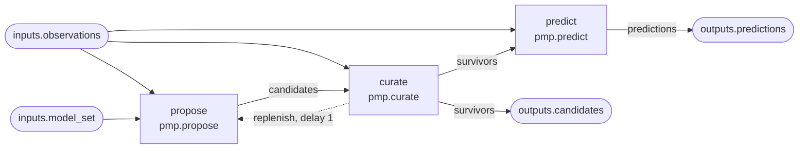

# Starting workflow: `pmp.continuous-forecast`

- **Version:** PMP 0.1.0; workflow definition `pmp.continuous-forecast` 0.1.0
- **Status:** Draft. The workflow, its capabilities and its message types are draft catalog entries
  whose shapes are placeholders until module teams and `ode-uq-spec` settle them
  ([open-questions.md](../open-questions.md), OQ-15).
- **Requirement keywords:** MUST, MUST NOT, SHOULD, SHOULD NOT and MAY are used as described in
  [RFC 2119](https://www.rfc-editor.org/rfc/rfc2119).

Praenora keeps models and predictions current as target data arrives. The starting workflow states
that loop in this project's terms: each tick, a population of candidate models is proposed and
fitted to the data so far, curated against the new observations, and used to issue probabilistic
predictions. It is the catalog entry
[`pmp.continuous-forecast@0.1.0`](../../spec/catalog/workflows/pmp.continuous-forecast/0.1.0.json).

The runtime validates the workflow's graph like any other (the tests do), but the workflow cannot
run until modules implement its capabilities. The runtime does not hard-code it: changing it is a
catalog change (a new version of the definition once versions are bumped again;
[compatibility-policy.md](compatibility-policy.md#changing-a-version)), never a code change.

## Graph

The dashed connection is the feedback connection: `curate` may ask `propose` for more candidates,
and `propose` receives the request in the next tick.

## Steps

| Step | Capability (draft) | Inputs | Outputs | What it does |
|---|---|---|---|---|
| `propose` | [`pmp.propose@0.1.0`](../../spec/catalog/capabilities/pmp.propose/0.1.0.json) | `observations`, `model_set`, `replenish` (optional) | `candidates` | Proposes a population of candidate models from the model set, each fitted to the data so far, and adds candidates when a replenishment request arrives. |
| `curate` | [`pmp.curate@0.1.0`](../../spec/catalog/capabilities/pmp.curate/0.1.0.json) | `candidates`, `observations` | `survivors`, `replenish` (optional) | Keeps the candidates that remain consistent with the data, updating their statuses and parameters, and requests more candidates when the population becomes too small or too uniform. |
| `predict` | [`pmp.predict@0.1.0`](../../spec/catalog/capabilities/pmp.predict/0.1.0.json) | `candidates`, `observations` | `predictions` | Issues probabilistic predictions from the surviving candidates, for example quantiles of each variable over time. |

## Inputs, outputs and connections

| Workflow input | Message type | Typical source |
|---|---|---|
| `observations` | [`pmp.observation-batch@0.1.0`](../../spec/catalog/messages/pmp.observation-batch/0.1.0.json) | `observation-csv`: the target data, replayed one tick window at a time. |
| `model_set` | [`pmp.model-set@0.1.0`](../../spec/catalog/messages/pmp.model-set/0.1.0.json) | `json-document`: the same set of model artifacts every tick. |

| Workflow output | Message type | Fed by |
|---|---|---|
| `predictions` | [`pmp.prediction-set@0.1.0`](../../spec/catalog/messages/pmp.prediction-set/0.1.0.json) | `predict.predictions` |
| `candidates` | [`pmp.candidate-set@0.1.0`](../../spec/catalog/messages/pmp.candidate-set/0.1.0.json) | `curate.survivors` |

| From | To | Delay |
|---|---|---:|
| `inputs.observations` | `propose.observations` | 0 |
| `inputs.model_set` | `propose.model_set` | 0 |
| `propose.candidates` | `curate.candidates` | 0 |
| `inputs.observations` | `curate.observations` | 0 |
| `curate.survivors` | `predict.candidates` | 0 |
| `inputs.observations` | `predict.observations` | 0 |
| `curate.replenish` | `propose.replenish` | 1 |
| `predict.predictions` | `outputs.predictions` | 0 |
| `curate.survivors` | `outputs.candidates` | 0 |

The schedule is `propose, curate, predict`. In tick `t`, every step receives the observation batch of
the tick's window and `propose` the model set; `propose` also receives the replenishment request that
`curate` made in tick `t - 1`, if it made one (never in tick 0). The graph satisfies every rule of
[workflow-definitions.md](workflow-definitions.md#graph-rules): the feedback connection has delay 1
and feeds an optional input, and the delay-0 connections form no cycle.

## Message types

| Message type | Status | Data |
|---|---|---|
| [`pmp.observation-batch@0.1.0`](../../spec/catalog/messages/pmp.observation-batch/0.1.0.json) | stable | The tick's window, the time unit and the long-form observation rows. |
| [`pmp.model-set@0.1.0`](../../spec/catalog/messages/pmp.model-set/0.1.0.json) | draft | `models[] {id, href, sha256}`. |
| [`pmp.candidate-set@0.1.0`](../../spec/catalog/messages/pmp.candidate-set/0.1.0.json) | draft | `candidates[] {id, model {href, sha256}, parameters, status, origin}`. |
| [`pmp.replenishment-request@0.1.0`](../../spec/catalog/messages/pmp.replenishment-request/0.1.0.json) | draft | `requested` (at least 1) and `reason`. |
| [`pmp.prediction-set@0.1.0`](../../spec/catalog/messages/pmp.prediction-set/0.1.0.json) | stable | The time of issue, the time unit and the long-form prediction rows, including quantiles. |

- Model sets and candidate sets refer to model artifacts by `href` and `sha256` instead of embedding
  them, so messages stay small and an artifact can be checked against its digest.
- The draft types require only their core fields and accept `x-` extension properties at the top of
  the data and in each item, so module teams can try out fields before the shapes are final.
- The row fields of the two stable types are in [protocol.md](protocol.md#message-types).

## Runtime services (planned)

Steps that simulate models or convert model descriptions are expected to use runtime services
through the host API's `get_service()` rather than bundle their own engines: a simulation service
backed by libRoadRunner (`praenora.simulation@0`) and a model-conversion service backed by
libAntimony (`praenora.model-conversion@0`). Neither exists in this version
([ADR-0021](../adr/ADR-0021-runtime-services-through-host-api.md)).

## Assessment variant (planned)

A later workflow, `pmp.continuous-forecast-assessed`, is planned to add a step `assess` with the
capability [`pmp.assess@0.1.0`](../../spec/catalog/capabilities/pmp.assess/0.1.0.json), which
scores predictions against known values in synthetic scenarios whose truth is known, producing
[`pmp.assessment@0.1.0`](../../spec/catalog/messages/pmp.assessment/0.1.0.json). The capability and
the message type are draft catalog entries already; the workflow definition is not.

## Running it

A configuration that pins `pmp.continuous-forecast@0.1.0` MUST bind the steps `propose`, `curate`
and `predict` to modules whose manifests list `pmp.propose`, `pmp.curate` and `pmp.predict` at
version 0.1.0, and bind the inputs `observations` and `model_set` to data sources. Until such
modules exist, `praenora graph --workflow pmp.continuous-forecast@0.1.0` shows the graph and its
schedule.

## AsyncAPI document

The generated AsyncAPI document of the workflow, with one channel per connection source, is
committed as
[`pmp.continuous-forecast-0.1.0.asyncapi.json`](../../spec/asyncapi/pmp.continuous-forecast-0.1.0.asyncapi.json)
([protocol.md](protocol.md#asyncapi-documents)).

## References

- [ADR-0010](../adr/ADR-0010-workflow-definitions-as-catalog-data.md): workflow definitions as catalog data.
- [ADR-0011](../adr/ADR-0011-tick-based-synchronous-execution.md): ticks and feedback connections.
- [ADR-0021](../adr/ADR-0021-runtime-services-through-host-api.md): runtime services.
- [open-questions.md](../open-questions.md): OQ-15 (final shapes), OQ-16 (the simulation service).
